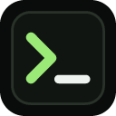
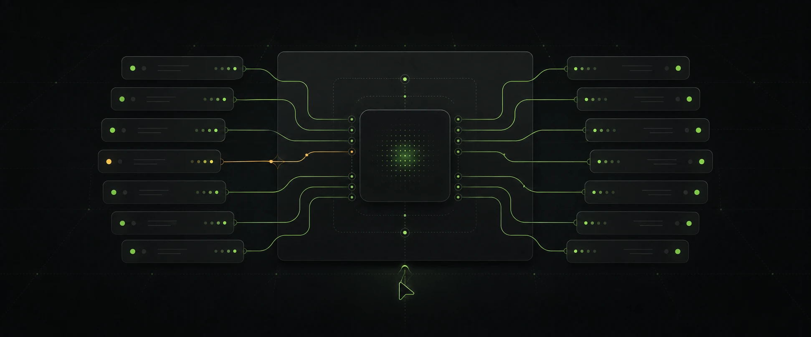
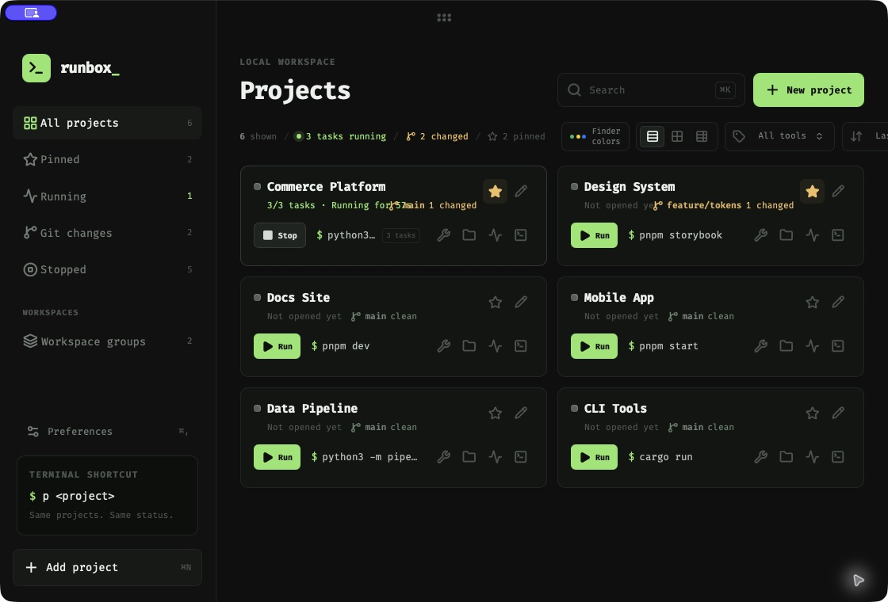
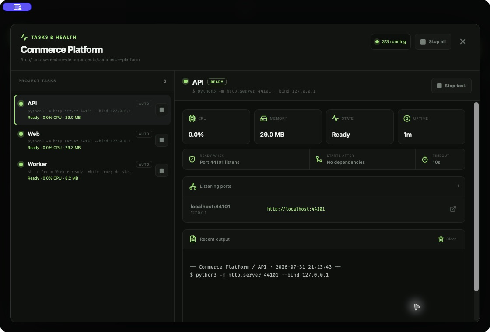
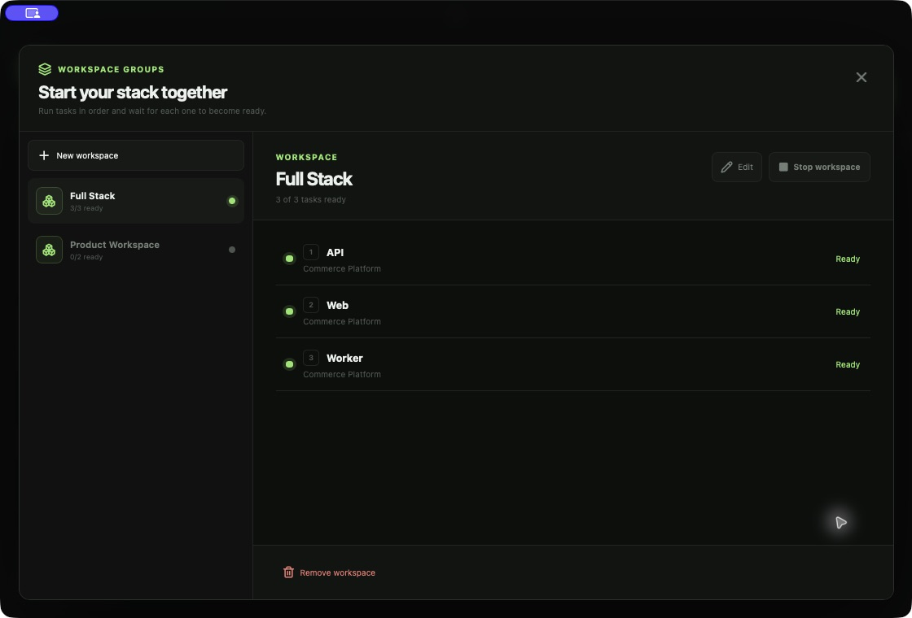

<p align="center">
  
</p>

<h1 align="center">Runbox</h1>

<p align="center">
  <strong>A local control plane for the projects running on your Mac.</strong><br>
  <strong>把散落在终端里的本地开发项目，收进一个可以启动、观察和管理的工作台。</strong>
</p>

<p align="center">
  
  
  
  
</p>

<p align="center">
  
</p>

<p align="center">
  <a href="#english-overview">English</a> ·
  <a href="#中文介绍">中文介绍</a> ·
  <a href="#product-tour--产品预览">Product tour</a> ·
  <a href="#download--安装">Download / 安装</a> ·
  <a href="#quick-start">Quick start</a>
</p>

## Download / 安装

<p align="center">
  <a href="https://github.com/siyuhuh/project-launcher/releases/latest"><strong>⬇️ Download the latest Runbox release / 下载最新版 Runbox</strong></a>
</p>

请优先从 [GitHub Releases 最新版本页面](https://github.com/siyuhuh/project-launcher/releases/latest) 下载，
不要从仓库的绿色 Code 按钮下载源码。根据你的系统选择对应安装包：

| 系统 | 下载文件 | 安装方式 |
| --- | --- | --- |
| macOS Apple Silicon（M1/M2/M3/M4） | `Runbox_*_aarch64.dmg` | 打开 DMG，把 Runbox 拖进 Applications |
| macOS Intel | `Runbox_*_x64.dmg` | 打开 DMG，把 Runbox 拖进 Applications |
| Windows | `.msi` 或 `-setup.exe` | 双击安装包，按向导完成安装 |

### macOS 首次打开

当前公开构建使用临时签名，尚未接入 Apple Developer ID notarization。首次打开时，macOS 可能需要：

1. 在 Applications 中找到 Runbox，按住 Control 点击，选择 **Open**。
2. 如果仍然拦截，打开 **System Settings → Privacy & Security**，点击 **Open Anyway**。
3. 如果提示 “Runbox.app is damaged and can’t be opened”，先把 App 放进 Applications，再在 Terminal 执行：

   ```bash
   xattr -dr com.apple.quarantine /Applications/Runbox.app
   open /Applications/Runbox.app
   ```

后续接入 Apple Developer ID 签名和公证后，Mac 用户就可以直接双击打开，不再需要上述处理。

### Windows 首次打开

请从上面的官方 Release 页面下载安装。如果 Windows SmartScreen 提示未知发布者，确认文件来自该 Release
页面后，点击 **More info → Run anyway**。

## English overview

As a local workspace grows, the difficult part is often no longer the code. It is remembering which
terminal tab runs the Web app, which command starts the API, what port a service chose, and why a
Worker stopped.

Runbox turns project folders and development commands into one visible workspace:

- **Launch projects without memorizing commands.** Run Web, API, Worker, and other tasks
  independently or together.
- **See what is actually happening.** Inspect localhost ports, CPU, memory, uptime, logs, and
  abnormal exits for every task.
- **Start in a reliable order.** Declare task dependencies and wait for a process, port, HTTP
  endpoint, or log message before launching the next service.
- **Manage Git without changing context.** Review diffs and history, stage files, commit, switch
  branches, and sync repositories from the same window.
- **Start a complete stack with one click.** Combine tasks from multiple projects into reusable
  Workspace Groups.
- **Use the desktop app or Terminal.** The companion `p` command reads the same projects, runtime
  state, and logs.
- **Keep the setup local and lightweight.** Runbox uses the commands and tools already installed on
  the Mac. It does not require Docker or take over a project's environment.

The interface is deliberately quiet: a compact, terminal-inspired dashboard with adjustable
scaling and locally saved themes.

## 中文介绍

本地项目一多，最先失控的往往不是代码，而是终端：哪个标签页在跑 Web，API
该用哪条命令，服务占了什么端口，Worker 又为什么突然退出。

Runbox 把项目目录和开发命令整理成一个可见的本地工作台：

- **不用再记启动命令。** Web、API、Worker 等任务既能单独运行，也能随项目一起启动。
- **真正看见项目状态。** 直接查看 localhost 地址、端口、CPU、内存、运行时间、日志和异常退出码。
- **按可靠顺序启动。** 为任务设置依赖，并通过进程、端口、HTTP 地址或日志关键字判断是否就绪，
  上一步 Ready 后才启动下一步。
- **少切一次应用。** 在同一个窗口里查看 Git diff 与历史、暂存文件、提交、切换分支和同步仓库。
- **一键拉起完整开发环境。** 用 Workspace Groups 把不同项目里的任务组合成可复用的工作区。
- **桌面与终端共用一套数据。** 在 App 里点击运行，也可以直接输入 `p 项目名`。
- **本地、轻量、不接管项目。** Runbox 使用 Mac 上已经安装的命令与开发工具，不要求 Docker，
  也不会改变项目原本的技术栈。

它更像一个“本地开发项目控制台”，而不是新的容器平台或 IDE。

## Product tour / 产品预览

### One workspace for every local project / 所有本地项目，一个工作台

Scan project activity, Git state, commands, and running tasks without searching through terminal
tabs. Switch between comfortable cards, a compact grid, and a dense table view.

在一个页面里查看项目运行状态、Git 变化与启动命令，并按需要切换卡片、紧凑或表格视图。

<p align="center">
  
</p>

### Tasks that become reliably ready / 不只 Running，还要真正 Ready

Inspect CPU, memory, uptime, localhost ports, logs, dependencies, and readiness checks for every
task. Runbox can wait for a process, port, HTTP endpoint, or log phrase before moving on.

每个任务都能看到 CPU、内存、端口、日志、依赖与就绪条件；Runbox 会等它真正 Ready 再继续。

<p align="center">
  
</p>

### Start a complete stack in order / 按顺序启动整套开发环境

Workspace Groups launch Web, API, Worker, or tasks from different repositories in a saved order.
Each step waits for readiness, and failed launches roll back the processes started in that run.

Workspace Groups 会按保存顺序启动 Web、API、Worker；失败时回滚本次新启动的进程，避免留下半套环境。

<p align="center">
  
</p>

## Quick start

### Desktop app

Requirements: macOS, [Node.js](https://nodejs.org/), [pnpm](https://pnpm.io/), Rust, and the Xcode Command Line Tools.

```bash
pnpm install
pnpm app:dev
```

Build an installable app:

```bash
pnpm app:build
```

The macOS app and DMG are written to `target/release/bundle/`.

### Terminal command for installed app users

普通用户不需要 clone 源码，也不需要安装 Rust。Release 页面提供了独立的 `p` CLI，给 Codex 或
其他终端工具批量导入项目使用。

macOS：

```bash
curl -fsSL https://raw.githubusercontent.com/siyuhuh/project-launcher/main/scripts/install-cli.sh | bash
```

Windows PowerShell：

```powershell
irm https://raw.githubusercontent.com/siyuhuh/project-launcher/main/scripts/install-cli.ps1 | iex
```

安装完成后，打开新的 Terminal / PowerShell 窗口，再运行：

```bash
p --help
```

### Terminal command from source

只有参与 Runbox 开发、从源码运行项目时，才需要：

Install the companion `p` command:

```bash
pnpm cli:install
```

Make sure `~/.cargo/bin` is in `PATH`, then:

```bash
p                         # list every project and its status
p my-web                  # start by name
p my-web api              # start one task
p start my-web
p tasks my-web            # inspect tasks and health
p stop my-web
p logs my-web api
p logs my-web --follow
p workspaces
p workspace full-stack
p workspace full-stack --stop
p add ~/Projects/my-web
p remove my-web
```

The desktop app and CLI read the same project list, runtime state, and logs. `p list` also shows
the current Git branch and working-tree summary.

## Import many projects with an agent

Runbox deliberately does not crawl your disk by itself. Codex or another local coding agent can inspect a workspace, choose the real application roots, and add them safely. For the installed app, install the standalone `p` CLI first using the command above; cloning this repository is not required.

Copy this prompt into your agent:

```text
Scan my local workspace for project roots. Look for Git repositories and common
launch manifests such as package.json, pnpm-lock.yaml, Cargo.toml, justfile, and
Docker Compose files.

If the `p` command is not available, tell the user to install the standalone Runbox
CLI from the latest Release page. Do not ask the user to clone the Runbox source
repository just to install the CLI.

For each project with a clear dev or start command:
1. Use the folder name as the friendly project name.
2. Skip node_modules, build output, research copies, archives, snapshots, and
   repositories without a runnable development command.
3. Run: p add "<absolute-project-path>" --name "<friendly-name>"
4. If automatic detection is wrong, pass --command "<correct-command>".
5. Do not start any project during import.
6. Finish with p list and report what was added and what was skipped.
```

The workflow an agent should follow is:

```bash
# Inspect only — identify repositories and manifests
find /path/to/workspace -type d -name .git

# Add or update a detected project
p add "/path/to/workspace/my-web" --name "my-web"

# Override detection when needed
p add "/path/to/workspace/desktop-app" \
  --name "desktop-app" \
  --command "pnpm app:dev"

# Verify without starting anything
p list
```

`p add` is idempotent by canonical project path. Re-running the scan updates an existing entry instead of creating a duplicate. Machine-specific project paths remain in the local Runbox data directory and are never committed to this repository.

## How commands run

Every project task runs:

1. inside the configured project directory;
2. through the user's login shell;
3. in its own process group so **Stop** also stops child processes;
4. with stdout and stderr appended to the project's Runbox log.

This keeps tools configured through `.zshrc`, NVM, Homebrew, pnpm, and similar shell setup available to projects.

> Runbox executes the command you save. Only add projects and commands you trust.

## Automatic command detection

When a folder is selected, Runbox inspects common project files:

- `package.json` scripts plus pnpm/npm/yarn/bun lockfiles;
- `justfile`;
- Docker Compose files;
- `Cargo.toml`;
- `pyproject.toml`.

Detected scripts become editable tasks. Long-running scripts such as `dev`, `web`, `api`, and
`worker` are included in **Run project** by default; one-shot scripts such as `build`, `test`, and
`lint` remain available for manual launch.

## Git status

For folders inside a Git worktree, Runbox reads `git status --porcelain=v2 --branch` in the
background and shows the branch, clean/changed state, and ahead/behind counts. The **Git changes**
sidebar filter narrows the workspace to projects with local changes.

Click the Git status on a project to open its Git workspace. The first Git client release covers the
core GitHub Desktop workflow:

- review staged and unstaged file diffs;
- stage or unstage individual files or all files;
- commit staged changes;
- switch local branches or create a branch;
- fetch, fast-forward pull, push, or publish a branch;
- browse recent commits with paginated loading and inspect commit metadata, changed files, and patches;
- open the committed history for a file directly from its working-tree diff;
- safely revert a non-merge commit by creating a new commit.

Background checks remain local and read-only. Network operations only run after an explicit click.
Pull uses `--ff-only`, Runbox does not force-push, and destructive discard/reset actions are not
exposed. Revert also requires a clean working tree. If Git reports a conflict, Runbox aborts the
operation instead of leaving a partial revert; merge commits remain view-only because choosing
their mainline parent is ambiguous.

### AI commit messages

Stage the files you want to commit, choose a provider in the commit box, and click **Generate**.
Runbox fills the commit textarea so you can review or edit the result before committing. It never
commits automatically.

**A local model is optional.** Runbox works with Codex, Cursor, or ordinary manual commit messages
without Ollama. If no local model is detected, the commit box shows a small setup prompt that can be
dismissed with **Not now**. Runbox never installs Ollama or downloads a model automatically.

Providers are discovered from the login shell:

- **Ollama** — every model shown by `ollama list` is available. The staged diff stays on the Mac.
- **Codex** — uses `codex exec` with an ephemeral session and a read-only sandbox. It reuses the
  existing Codex CLI login.
- **Cursor** — uses `cursor-agent` in read-only ask mode and reuses the existing Cursor login.

To opt into local generation, install [Ollama](https://ollama.com/download), then add a model:

```bash
ollama pull qwen3:4b
```

`qwen3:4b` is the lightweight default recommendation (about 2.5 GB). `qwen3:8b` produces stronger
results on capable machines but requires about 5.2 GB. Any model returned by `ollama list` appears
automatically in Runbox.

Only staged changes, their summary, the branch name, and recent commit subjects are included in the
generation context. Codex and Cursor are cloud providers, so their selected context is sent to that
provider; choose Ollama when repository content must remain local. Runbox does not store model
credentials or generated diff context.

## Developer tools

Click the wrench on any project to open its developer tools. Runbox detects Cursor, Visual Studio
Code, Zed, Nova, Sublime Text, and common JetBrains IDEs from their command-line launcher or macOS
application bundle. The same panel also opens Terminal and Finder at the project root, plus a
browser-friendly `origin` remote when one is configured.

These shortcuts only open the selected tool. Runbox does not install editors, execute editor tasks,
or send project contents anywhere.

## Project views

All views use the same project data, search, filters, sort order, pinned projects, and Git status:

- **Comfortable** — two-column cards with more room for branch and command details;
- **Compact** — the original three-column overview for large workspaces;
- **Table** — a Notion-style data grid for scanning project, activity, Git, command, and actions.

The selected view is saved locally and restored the next time Runbox opens.

## Project tasks and health

Click the activity icon on a project to open **Tasks & Health**. Each task has its own process group,
runtime record, and log. Tasks can be started or stopped individually, while the main project
button starts every task marked **Run with project**.

For running tasks, Runbox aggregates CPU and memory across the full process group and detects
listening TCP ports. Detected addresses open as `localhost` links. When a command exits, Runbox
records its exit code and distinguishes successful completion, a manual stop, and an abnormal exit.

Each task can also define a readiness check and dependencies:

- **Process** — ready after the command stays alive through the startup grace period;
- **Port** — ready when the configured TCP port is listening from that task's process group;
- **HTTP** — ready when an `http://` endpoint responds;
- **Log phrase** — ready when recent output contains the configured text.

Runbox resolves transitive dependencies, starts them in topological order, and waits up to the
configured timeout before continuing. The Health panel exposes the full lifecycle—Waiting,
Starting, Running, Ready, Blocked, Exited, and Crashed. If an expected port is occupied before
launch, Runbox blocks the task and shows the process name, PID, and command using it.

中文说明：每个任务都可以设置“启动前依赖”和“就绪条件”。Runbox 会先启动依赖任务，等待它们
真正 Ready，再继续启动下游服务；如果超时、异常退出或端口被占用，本次启动会停止并回滚由它
新拉起的任务，避免留下半套环境。

Existing projects migrate automatically: their saved command becomes the primary `Dev` task and
keeps its existing runtime and log files.

## Workspace groups

Open **Workspace groups** from the sidebar to combine tasks across projects. A group can start or
stop a complete local stack—such as Web, API, and Worker—without changing the individual project
configuration. Groups are also available from Terminal with `p workspaces` and
`p workspace <name>`.

Group entries run in the order they were selected. Each entry still honors its own same-project
dependencies and readiness check, so a Web → API → Worker workspace advances only when the current
step is actually usable. On failure, Runbox reports the blocked task and rolls back processes it
started for that launch.

## Appearance preferences

Open **Preferences** from the sidebar or press `⌘,`. Interface scaling ranges from 80% to 160% and
applies to the entire window, including Git history, diffs, and developer tools. Use `⌘+`, `⌘−`,
and `⌘0` for quick resizing.

Runbox includes Runbox, Graphite, Spool, and Solarized themes. Scale and theme preferences are saved
locally and restored on the next launch.

### Finder tag colors on macOS

Projects imported from the CLI have not yet been selected by the desktop app. If Runbox shows
**Finder colors**, click it once and choose the parent folder that contains your projects. macOS
remembers that folder access, and Runbox then mirrors its Finder tag dots automatically.

## Local data

Runbox keeps machine-specific paths and logs out of Git. On macOS they live in:

```text
~/Library/Application Support/Runbox/
├── projects.json
├── groups.json
├── logs/
└── runtime/
```

## Stack

- Tauri 2 / Rust for process and filesystem control
- React 19 / TypeScript / Vite for the UI
- One small Rust core shared by the desktop app and CLI

## License

MIT
